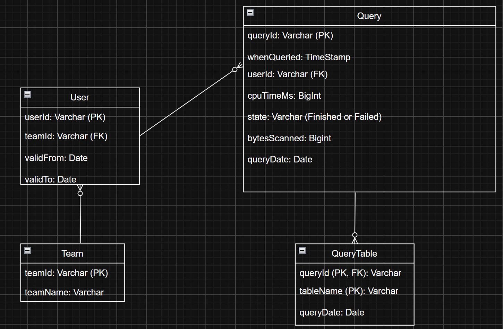

# Meta DWH for Trino Table Usage

> The project takes raw query events from Trino (one event per finished query), splits the data into separate related tables and then analyzes it with example SQL queries, e.g. who used a table or how many resources a team consumed.

---

## How to run

Create and activate a virtual environment, then install DuckDB:

```bash
py -3.12 -m venv .venv
```

```bash
.venv\Scripts\activate
```

```bash
python -m pip install duckdb
```

Generate fake raw data, load it day by day and run the example queries:

```bash
python generateFakeData.py
```

```bash
python runPipeline.py 2023-01-01 2023-01-31
```

```bash
python runExampleQueries.py
```

---

## Assumptions

### `RawData` contains the following columns:

| Column | Type | Description |
|---|---|---|
| `queryId` | `VARCHAR` | unique query ID (the same ID can appear twice in raw data because of duplicate events) |
| `whenQueried` | `TIMESTAMP` | when user started the query |
| `whenReceived` | `TIMESTAMP` | when the event was received, used to keep the newest copy of a duplicate |
| `userId` | `VARCHAR` | which user ran the query |
| `cpuTimeMs` | `BIGINT` | CPU time used by the query, in milliseconds |
| `bytesScanned` | `BIGINT` | bytes scanned during query |
| `state` | `VARCHAR` | Finished or Failed state of query |
| `tablesAnalyzed` | `VARCHAR[]` | which tables were used during the query |

### Other assumptions

- Users are mapped to teams through the `User` table. Each user belongs to one team at a time. In reality this list would come from the company's HR or employee directory, refreshed daily, and is joined to `Query` to sum resources per team.
- A query that reads several tables counts as one use of each of those tables. Resources are counted once per query (from `Query`), so they are never counted twice.
- Failed queries are kept because they still use resources
- Duplicates are possible, the newest event per `queryId` wins
- Team history: users can change teams. `User` keeps one row per period in a team (`validFrom` inclusive, `validTo` exclusive, `9999-12-31` = still valid), so each query is counted for the team the user belonged to on the day of the query. In the fake data Anna moves from Team A to Team B on 2023-01-05.

---

## Data model



| Table | One row = |
|---|---|
| `RawData` | one raw event, exactly as it arrives (can contain duplicates) |
| `Team` | one team |
| `User` | one period of a user in one team |
| `Query` | one query with its resource usage |
| `QueryTable` | one table read by one query |

- `RawData` is kept so the whole DWH can be rebuilt from it if the logic changes.
- `QueryTable` was added because a query can read many tables and a table is read by many queries (many-to-many). Keeping one row per query × table makes questions about tables simple joins instead of searching inside a list.

---

## Resource metrics

- `cpuTimeMs` – main measure of compute cost
- `bytesScanned` – how much data was read from S3
- `state` – failed queries also use resources, so they are counted too

With real Trino data I would also add peak memory and wall time.

---

## How data is updated

The pipeline runs once per day and loads only that day. If a day is run again, its rows are deleted first and then loaded again, so there are never duplicates. Passing a date range (e.g. `runPipeline.py 2023-01-01 2023-01-31`) reloads older days as well (backfill).

---

## Example queries

The queries are in [`sql/exampleQueries.sql`](sql/exampleQueries.sql).

### How many distinct users queried the table X during a given period?

Finds every query that read `orders` in `QueryTable`, joins `Query` to see who ran it and counts each user once.

| distinct_users |
|---|
| 5 |

### How many resources did the team Y consume during that period?

Starts from `Query` (one row per query, so nothing is counted twice), joins `User` and `Team` and sums the resources for `Team A`.

| teamName | total_queries | failed_queries | total_cpu_time_minutes | total_GB_scanned |
|---|---|---|---|---|
| Team A | 23 | 4 | 106.16 | 741.36 |

*Both examples use the period 2023-01-01 – 2023-01-10.*

---

## Limitations and next steps
- Users missing from `User` (e.g. service accounts) are dropped by the join. They could go to an "Unmapped" team instead.
- Cost per table: splitting the CPU of a multi-table query between its tables would show which tables are the most expensive.
